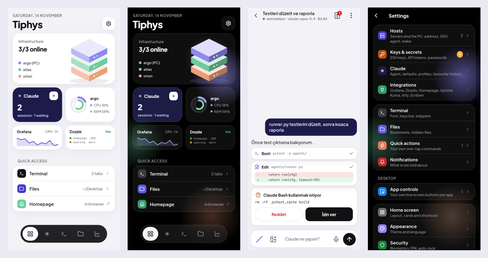
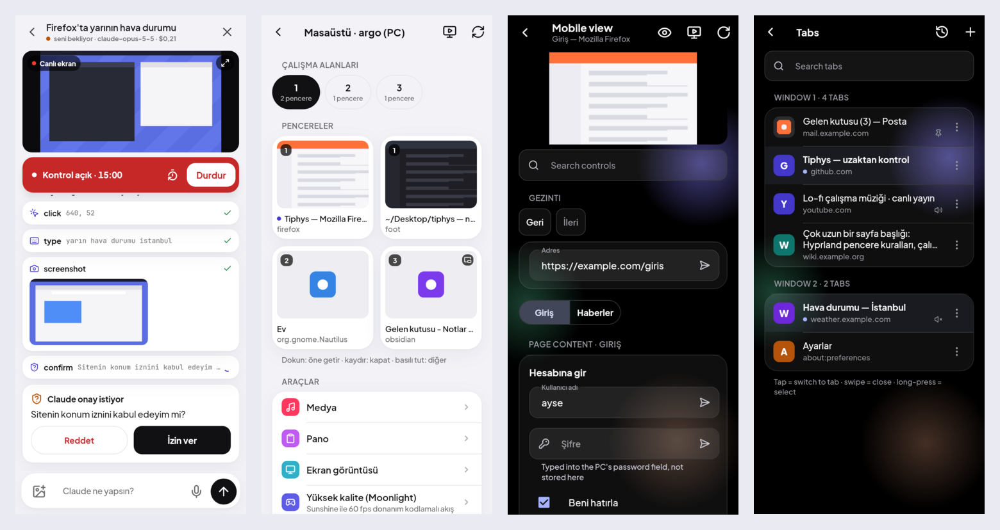
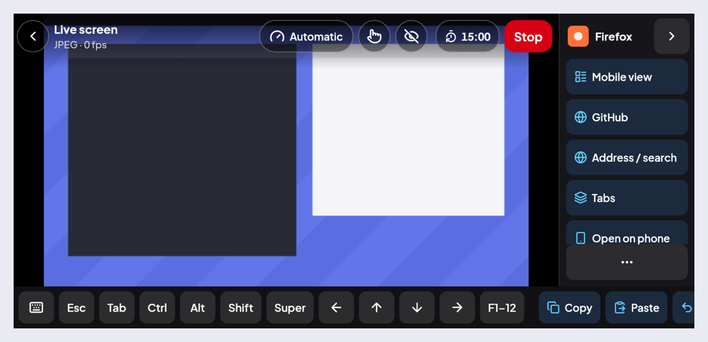

# Tiphys

**Control your PC and servers from your phone, over your own Tailscale network.**

Tiphys is a phone app (Flutter; Android, plus iOS and desktop builds) and a small agent (Node.js/TypeScript) that
runs on each machine you want to reach: Linux, macOS or Windows. The phone talks to your machines directly over
[Tailscale](https://tailscale.com). No third-party cloud sits in the path, and Google/Firebase is not used for
notifications. You can run Claude Code sessions from the phone, open a terminal, browse files, review and push git
changes, watch services and dashboards, and operate your desktop: window panel, live screen, per-app remote
controls, Firefox tabs and an accessibility-based "mobile view" of desktop apps. Each machine has to pair the phone
before its agent accepts requests. Features that can change the desktop are off by default and run only inside a
short, visible control session.

**Install in one line** on each machine, then scan the QR code it prints:

```sh
curl -fsSL https://raw.githubusercontent.com/aurict/tiphys/main/install.sh | sh
```

*Named after Tiphys, the helmsman of the Argo.* · Interface: English and Turkish.







## Features

| Area | What you get |
|---|---|
| **Claude Code** | Start sessions in any allowed folder, stream answers live, approve tool permissions (also from the notification), photo and voice input, slash commands, cost and context usage, git worktree sessions, scheduled tasks, "while you were away" summary, a per-session changes view with commit/push/revert, offline outbox. Sessions live on the agent and survive app and agent restarts. Claude Code sessions running in a PC terminal are listed read-only and can be taken over. See [docs/features/claude.md](docs/features/claude.md). |
| **Claude uses the PC** | A "Use the PC" session type: Claude gets screenshot/click/type/key/window/app tools, Firefox tab tools and accessibility-tree tools, and nothing else. It runs inside a control session with code-enforced guardrails. See [docs/features/claude.md](docs/features/claude.md). A "security fix" session type fixes selected security findings over SSH with backups, rollback and a sudo password typed on the phone. |
| **Desktop (Hyprland)** | Window panel (workspaces, thumbnails, focus/close/fullscreen/float/pin/move), app launcher, DPMS, media (MPRIS) and volume, clipboard sync, screenshots, "open on PC". See [docs/features/desktop-control.md](docs/features/desktop-control.md). |
| **Live screen** | MJPEG or hardware H.264 (NVENC) stream via `wf-recorder`, direct-touch and touchpad modes, keyboard bar, adaptive quality. Optional high-quality mode through Sunshine/Moonlight, including PIN pairing from the app. |
| **App-aware remotes & mobile view** | A remote strip that follows the focused app (Firefox, VS Code, Zed, kitty, file managers, mpv/VLC, generic), user-defined buttons, and a "mobile view" that renders the focused window's AT-SPI accessibility tree as native phone controls. See [docs/features/remotes-and-mobile-view.md](docs/features/remotes-and-mobile-view.md). |
| **Firefox bridge** | Extension + native messaging: list, switch, open, close, pin and mute tabs, send a tab to the phone, a reader view, page media controls, scrolling and typing (page access is an optional permission). See [docs/features/firefox-bridge.md](docs/features/firefox-bridge.md). |
| **Game mode** | A laptop next to the PC becomes an ambient second screen while you play Euro Truck Simulator 2: the Velour song with cover colours, spectrum and synced lyrics, the ETS2 cockpit, a live map built from your own game files, and notices for fines, tolls and deliveries. Started and stopped from the phone; nothing is recorded. See [docs/features/game-mode.md](docs/features/game-mode.md). |
| **Terminal, files, git** | One-tap SSH with tmux and auto-reconnect, extra-key bar and snippets. SFTP browser and editor, transfers, Android "Share" to the PC. Git status/diff/stage/commit/push/pull/branches/history. See [docs/features/terminal-files-git.md](docs/features/terminal-files-git.md). |
| **System** | CPU/RAM/GPU/disk, systemd services, Docker, Compose stacks (over SSH), processes, open ports (share a localhost port to your tailnet), power, Wake-on-LAN, backup checks, cross-host log search, event timeline, audit log. See [docs/features/system.md](docs/features/system.md). |
| **Monitoring** | Native Grafana dashboards, alerts and quick queries; Dozzle logs; Uptime Kuma sites and maintenance windows; Homepage services; offline alerts for watched hosts. See [docs/features/monitoring.md](docs/features/monitoring.md). |
| **Notifications** | Through your own [ntfy](https://ntfy.sh) server via UnifiedPush, end-to-end encrypted with WebPush (RFC 8291). Covers Claude done/waiting/error, host offline, disk full, failed services, Grafana alerts, backups, long commands, agent restarts. See [docs/features/notifications.md](docs/features/notifications.md). |
| **Vault & notes** | An on-device password vault behind the app lock, with sensitive-clipboard copy and auto-clear. Quick notes go into Obsidian via `obsidian://`, so Obsidian LiveSync keeps its own end-to-end encryption. See [docs/features/vault-and-notes.md](docs/features/vault-and-notes.md). |
| **Settings & profile** | Everything is editable in the app. Export/import a single `.tiphys.json` profile. Secrets are left out, or included only in a passphrase-encrypted backup. |

## How it works

```
Phone (Tiphys)
  ├─ HTTPS / WebSocket / SSE ─▶ tailscale serve ─▶ agent on the PC "argo"       Claude, desktop, git, system…
  ├─ HTTPS / WebSocket / SSE ─▶ tailscale serve ─▶ agent on a server "atlas"    system, docker, alerts, uptime…
  ├─ SSH / SFTP ──────────────▶ any host                                        terminal, files, compose, logs
  └─ HTTPS ───────────────────▶ Grafana · Dozzle · Uptime Kuma · ntfy            monitoring, push

Firefox ─ native messaging ─▶ firefox-host ─▶ unix socket ─▶ agent on the PC
Agent ─ WebPush (encrypted) ─▶ your ntfy server ─▶ ntfy app (UnifiedPush) ─▶ Tiphys

(all traffic stays inside your tailnet)
```

- **`app/`**: Flutter Android app (Riverpod, go_router, dartssh2, xterm, UnifiedPush).
- **`agent/`**: Fastify + TypeScript service, one per machine. It listens on `127.0.0.1:7443` and is exposed
  only inside your tailnet with `tailscale serve`. Each feature has its own flag.
- **`firefox/`**: "Tiphys Bridge" Firefox extension (Manifest V3, no network access).
- **`schema/`**: JSON Schema of the profile file, generated from the agent's Zod definitions.
- **`tools/`**: deploy, pairing, schema sync, logo and resource-limited build helpers.

More detail: [docs/architecture.md](docs/architecture.md).

## Requirements

- A Tailscale tailnet with MagicDNS and HTTPS certificates enabled.
- **Agent:** Linux (systemd user services), macOS (launchd) or Windows. The installer brings its own Node.js 24;
  from source you need Node.js 22 or newer. About 110 MB of memory with the server features on.
  Desktop features: on **Hyprland** the agent drives the desktop itself (`grim`, `wl-clipboard`, `ydotool`, `wtype`,
  optionally `wf-recorder`, `ffmpeg`, `playerctl`, `wpctl`, Sunshine, `python3-gi`, `gir1.2-atspi-2.0`). On other
  desktops it starts the small native helper [`tiphys-desktop`](desktop-helper/README.md) (Rust, ~4 MB of memory,
  only while desktop features are in use): Sway, X11, GNOME/KDE on Wayland, Windows and macOS.
  Claude features need a Claude Code login on that machine.
- **App:** Android 8.0+ (API 26), arm64. Built with Flutter 3.47.9 / JDK 17. The same app also builds for
  **iOS** (15+) and as a **desktop app** for Linux, Windows and macOS; there UnifiedPush, the share menu and the
  Android-only native extras (H.264 decoder, Moonlight launch, screenshot blocking) are absent, notifications work
  only while the app is open, and pairing can paste the code instead of scanning it. CI compiles them
  (`flutter build ios --no-codesign`, `macos`, `windows`, `linux`); they are not signed or published. The Linux
  desktop build needs `libgtk-3-dev`, `libsecret-1-dev` and `libjsoncpp-dev`, and a Secret Service keyring at run
  time.
- **Optional:** your own ntfy server and the ntfy Android app for push; Firefox 140 ESR (or Developer Edition /
  Nightly) for the Firefox bridge; Grafana, Dozzle, Uptime Kuma, Homepage, Obsidian with LiveSync.

## Install

On each machine you want to reach (Linux or macOS; Tailscale installed and logged in):

```sh
curl -fsSL https://raw.githubusercontent.com/aurict/tiphys/main/install.sh | sh
```

Windows: `irm https://raw.githubusercontent.com/aurict/tiphys/main/install.ps1 | iex`

The installer verifies the release signature, installs the agent with its own Node.js as a user service, enables
the safe features it detects, runs `tailscale serve` and prints a QR code. Scan it in the app under
*Settings › Hosts › (host) › Pair with QR code*. `tiphys-agent doctor` checks the install. Packages (`.deb`, `.rpm`,
AUR, Homebrew) and a server Docker image: [packaging/README.md](packaging/README.md).

The app: build the APK and install it on your phone (or use the APK attached to a release).

From source instead (development, Firefox extension): build the agent, expose it with `tailscale serve`, then
`tools/pair.sh local`.

Step by step: **[docs/getting-started.md](docs/getting-started.md)**. Everything else (servers, systemd, signing,
every feature flag and setting, push, upgrades, backups, security checklist): **[docs/setup-guide.md](docs/setup-guide.md)**.

## Security at a glance

- **Network:** the agent binds to `127.0.0.1` and is published only inside your tailnet through `tailscale serve`.
  It can additionally require one specific Tailscale login (`--tailscale-login`).
- **Pairing:** each phone gets its own random token (`tph_…`) via QR code. The agent stores only its SHA-256 hash,
  and the phone keeps the token in Android Keystore-backed storage. Devices can be revoked one by one or all at once.
- **Risky features are off by default:** `claude`, `git`, `desktop`, `control`, `ports`, `wake`, `watch`,
  `alerts`, `backups` and others must be enabled explicitly per machine.
- **Control sessions:** anything that changes the desktop (input, window actions, app launch, browser, mobile view,
  Claude's PC tools) needs the `control` flag and a time-limited session token: 15 minutes by default, at most
  60 minutes remaining, one session at a time. The phone unlocks it with biometrics/PIN. While a session is open the
  PC shows it with a red/orange window border and a notification. Sessions are rate-limited and logged.
- **Claude guardrails:** PC sessions have no shell, file or web tools. Lock/exit/power shortcuts are blocked.
  Closing windows, pressing "delete/send/pay/…" controls, terminal input and unfamiliar URLs need your approval.
  Claude can never type into password fields.
- **Audit:** every non-GET request is written to an audit log; notable actions go to the event timeline.

What is *not* protected, and the full threat model: **[docs/security.md](docs/security.md)**. To report a
vulnerability, see [SECURITY.md](SECURITY.md).

## Documentation

| Document | Contents |
|---|---|
| [Getting started](docs/getting-started.md) | Quick start: Tailscale, PC agent, APK, pairing |
| [Setup guide](docs/setup-guide.md) | Full installation and configuration: PC and servers, upgrades, pairing, signing, every feature flag and setting, file locations, backups, security checklist |
| [Architecture](docs/architecture.md) | Components, repo layout, request/auth flow, profile, notifications, live screen, Claude sessions, storage |
| [Security](docs/security.md) | Threat model, every protection mechanism and its limits |
| [Agent configuration](docs/agent/configuration.md) | `agent.json` reference and feature flags |
| [Agent API](docs/agent/api.md) | HTTP/WebSocket/SSE endpoints and error codes |
| Features | [Claude](docs/features/claude.md) · [Desktop control](docs/features/desktop-control.md) · [Remotes & mobile view](docs/features/remotes-and-mobile-view.md) · [Firefox bridge](docs/features/firefox-bridge.md) · [Game mode](docs/features/game-mode.md) · [Notifications](docs/features/notifications.md) · [Monitoring](docs/features/monitoring.md) · [Vault & notes](docs/features/vault-and-notes.md) · [Terminal, files & git](docs/features/terminal-files-git.md) · [System](docs/features/system.md) |
| [Development](docs/development.md) | Tests, goldens, l10n, schema sync, code style |
| [Troubleshooting](docs/troubleshooting.md) | Common problems and agent error codes |
| [Contributing](CONTRIBUTING.md) · [Changelog](CHANGELOG.md) · [Third-party notices](THIRD_PARTY_NOTICES.md) | |

## Project status and limitations

Tiphys is a personal project that is used daily, published as-is. Expect rough edges.

What works where, and how well it is verified:

| | Linux (Hyprland) | Linux (Sway, X11, GNOME/KDE) | macOS | Windows |
|---|---|---|---|---|
| Agent: system, services, processes, ports, Docker, power | daily use | as Linux | built and tested in CI | built and tested in CI |
| Desktop: windows, live screen, input, clipboard | daily use | native helper, tested on X11 in CI | native helper, compiled in CI | native helper, compiled in CI |
| Mobile view, Sunshine, Claude's "use the PC" tools | daily use | not yet | not yet | not yet |

| App | Status |
|---|---|
| Android | daily use; signed APK in releases |
| iOS | compiled in CI (no signing); notifications only while the app is open |
| Linux / Windows / macOS desktop app | compiled in CI; notifications only while the app is open |

- "Compiled/tested in CI" means GitHub's real macOS/Windows machines build it and run the unit tests; it has not been
  tried on a real machine by the author. Reports are welcome.
- **Single user.** All paired devices of one person are equally trusted. There are no roles or per-device
  permissions.
- **Releases are new.** Until the first release is published, install from source. There is no prebuilt XPI. The
  Firefox extension is not signed by Mozilla, so installing it requires turning off signature checks (Firefox ESR,
  Developer Edition or Nightly only).
- Several paths are verified only with fakes and golden tests, not on every real device/app combination. See the
  open notes in [CHANGELOG.md](CHANGELOG.md).
- The key table for remote input assumes a US layout; some shortcuts may not match on other keyboard layouts.

## License

[MIT](LICENSE). Bundled third-party components are listed in [THIRD_PARTY_NOTICES.md](THIRD_PARTY_NOTICES.md).
