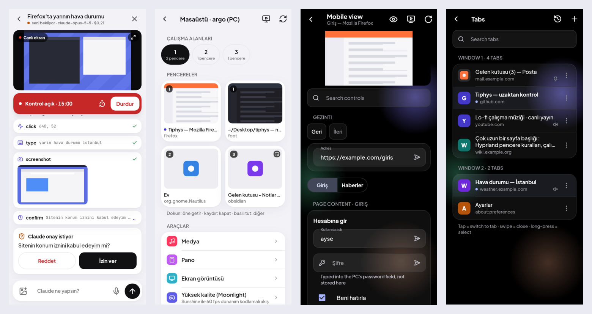

# Claude Code sessions

Tiphys runs [Claude Code](https://docs.anthropic.com/en/docs/claude-code) sessions **on the agent** (through the
Claude Agent SDK) and lets you drive them from the phone. A session keeps working when the phone disconnects, the
app is closed or the screen is off; the phone just reconnects and catches up.



There are three kinds of session:

| Kind | What Claude can do | Typical use |
|---|---|---|
| **Code** (default) | Claude Code as usual, in a folder under the agent's allowed roots, with your normal settings, tools, MCP servers and slash commands | coding, repo chores, scheduled reports |
| **Use the PC** | Only the built-in `tiphys_pc` tools: look at the screen, mouse, keyboard, Firefox tabs, accessibility tree. No shell, no file tools | "open tomorrow's weather in Firefox" |
| **Security fix** | Only the built-in `tiphys_sec` tools: read and change files and run commands on pinned machines over SSH, with backups, rollback and your sudo password typed on the phone. No other tools | "fix these findings from the security center" |

## Requirements

- Agent feature `claude` (off by default). The SDK is only loaded when the feature is on.
- Each Claude profile's config folder must already contain a Claude Code login (profiles are described below).
- Working folders must be inside the agent's `allowedRoots` (default `["~"]`). Symlinks are resolved before the check.
- Optional:
  - `git` feature: the **Changes** view (diff, commit + push, revert) and the separate-worktree option, which needs
    the `git` binary.
  - `transcribe` feature: voice messages in the chat.
  - **Use the PC** sessions need the `desktop` and `control` features, Hyprland, and an app lock set on the phone.
    See [Desktop control](desktop-control.md).
  - **Security fix** sessions need the `securityFix` feature on the same agent, at least one fix target and, to
    produce the brief, the `security` feature on the monitoring server. See
    [Security fix sessions](#security-fix-sessions).

## Enable

```sh
tiphys-agent init --name argo --features system,services,claude,git
```

`init --features` switches on the listed features and keeps the others (`--set-features` is an exact list). You
can also change features in the app: *Settings › Hosts › argo › Agent settings › Features*. Feature
changes apply after the agent restarts. All config keys are described in
[Agent configuration](../agent/configuration.md).

In the app, *Settings › Claude* picks the **agent that runs Claude** and sets the defaults: model, thinking effort,
permission mode, profiles, favourite folders and pinned slash commands.

### Profiles

A profile maps an id to a Claude config folder, which means a separate Claude account or setup:

```json
"claude": {
  "profiles": { "personal": "~/.claude", "work": "~/.claude-work" },
  "defaultProfile": "personal"
}
```

For any folder other than `~/.claude`, the session runs with `CLAUDE_CONFIG_DIR` pointing at it. History, the
"open in terminal" list and slash commands are all read from the selected profile. In the app (*Settings › Claude ›
Profiles*) you enter one profile per line as `id = config folder`. The profile picker only appears when more than
one profile exists.

## Starting a session

**Claude tab › New session:**

- **Folder**: a picker that only browses the agent's allowed roots (hidden folders are skipped).
- **First message** (optional). Without one, the session waits idle and the Claude process starts on the first
  message.
- **Permission mode**, **Thinking effort** (`low`, `medium`, `high`, `xhigh`, `max`), **Profile**, and **Model**
  (taken from your Claude settings default).
- **Separate git worktree**: creates a new branch `tiphys/<id>` in a sibling folder `<repo>-tiphys-<id>` from
  `HEAD`. Your working copy is not touched.

The Claude tab shows three lists. **Open sessions** are live on the agent. **Open in terminal** are Claude Code
sessions running on the PC outside Tiphys; they are read-only here unless you take them over. **History** lists
past sessions, which you can read and **Continue**.

Inside a session you can:

- send messages while Claude is working. They queue and are delivered in order.
- use slash commands. The list is what Claude really knows for that folder and profile; it is fetched without an
  API call and cached for 10 minutes.
- attach photos: up to 5 per pick and 10 per message. PNG, JPEG, GIF and WebP are sent as they are; other formats
  are converted to PNG with a 1568 px long edge.
- dictate a voice message. The recording is transcribed by the agent's Whisper command, and the text is added to
  the input box.
- **Stop** (interrupt) the current turn, change the permission mode, or **End session**.
- **Load earlier messages** from Claude's own transcript. Compaction boundaries are followed, so long sessions
  don't appear stuck.

Messages typed while offline go into an on-device **outbox** and are sent when the connection returns. Each one
carries a client id, so a retry is never processed twice.

If the agent restarts (an update or a crash), live sessions come back with the same id, marked *Agent restarted ·
continue where you left off*. Sessions that have been idle for 6 hours are closed; their history stays on disk and
can be continued.

### Permission modes

| Mode (app label) | SDK mode | Behaviour |
|---|---|---|
| Ask every time | `default` | every tool request comes to the phone |
| Accept edits, ask for commands | `acceptEdits` | file edits are auto-approved |
| Plan first | `plan` | Claude plans before acting |
| Don't ask | `bypassPermissions` | no prompts at all |

`bypassPermissions` must be chosen **when the session starts**. A running session cannot switch to it; start a new
session instead. PC sessions are always `default`. Security fix sessions use the same four modes, but they are enforced
by the tools themselves and mean something slightly different; see [Permission modes](#security-fix-permission-modes).

## Approving permission requests

When Claude wants a tool, the session status becomes *waiting for you* and the agent sends a high-priority
`claude.waiting` notification ("Claude needs your approval · wants to use *tool*") with **Allow** and **Deny**
buttons. Tapping a button sends the decision straight to the agent **without opening the app**, using the stored
token of the Claude agent host. If that fails, a *Could not send your decision* notification asks you to open
Tiphys. Waiting notifications are removed when the session finishes.

You can also answer from the permission card in the chat. You can turn off the "done" and "waiting" notifications
in the app's notification settings; see [Notifications](notifications.md).

When a turn ends, the `claude.done` notification includes the turn's cost, duration, the number of files changed
and the first line of the answer.

## Taking over a terminal session

Sessions you started with `claude` in a terminal on the PC appear under **Open in terminal**. The agent finds them
from Claude Code's `<config>/sessions/<pid>.json` files and checks `/proc` to confirm that the process is still
alive and is the same process.

**Take over on phone** (after you confirm):

1. only works while that session is **idle**. If Claude is busy in the terminal, you get *Try again when it
   finishes*.
2. sends `SIGTERM` to the terminal process and waits up to 8 s for it to exit. It never uses `SIGKILL`; if the
   process doesn't stop, you get *Close it on the PC and try again*.
3. resumes the same session on the agent with its full history.

To go back to the terminal later, run `claude --resume <session-id>` on the PC (or use the ready-made command, see
[Continue on the PC](#continue-on-the-pc)). Takeover uses Claude Code's own session files; it does not use tmux.

## Continue on the PC

Every live session summary carries a `resumeCommand` (see the [API](../agent/api.md#claude)), a client can offer as
*Continue on the PC*. It is a complete command for a terminal on the PC:

```sh
cd '/home/me/code/my-project' && claude --resume <sdkSessionId>
```

- The folder is the session's working folder, single-quoted for a POSIX shell, and the id is Claude Code's own session
  id (`sdkSessionId`). `resumeCommand` is `null` until Claude has reported that id (a session that has not yet
  produced its first message).
- **Stop the session on the phone first** (close it), or at least let the turn finish: the same conversation open in a
  terminal and in the agent at the same time would fork into two histories.
- Run it from the folder the command changes into. `claude --resume` **without an id** lists only the sessions of the
  **current folder**; a session started from the phone is saved under the folder chosen on the phone, so from your home
  directory it will not show up in that list. That is why the command starts with `cd`.
- Sessions that run in a terminal and are taken over on the phone, and the reverse direction, work the same way: the
  transcript is Claude Code's own session file, so either side can continue it.

## While you were away, and session changes

- **While you were away**: when you reopen a session, a card summarises everything since you last looked: turns,
  commands, files changed, cost and the last answer. You can save it as a note (see
  [Vault and notes](vault-and-notes.md)). The "last seen" position is stored on the phone per session and reset
  when the agent restarts.
- **Changes**: lists the files this session edited (`Edit`, `Write`, `MultiEdit`, `NotebookEdit`) with their
  current Git status and a diff per file. From there you can:
  - **Commit + push** only these files. Other changes stay out. The session title is suggested as the commit
    message. If the session ran in a worktree, the push sends the worktree branch; it doesn't merge anything.
  - **Revert** them to `HEAD`. Deleting files the session created is a separate, explicit checkbox.

  Files outside the repository are listed but never committed or reverted. These actions use the agent's git
  endpoints (see [Terminal, files and git](terminal-files-git.md)).

## Scheduled tasks

*Claude tab › alarm clock icon › Scheduled tasks.* Each task has a name, folder, prompt, permission mode, model,
effort, profile and one of these schedules:

| Schedule | Rule |
|---|---|
| Daily | every day at `HH:MM` |
| Weekly | chosen weekdays at `HH:MM` |
| Interval | every N minutes (minimum 15), counted from when the task was created or its timing last changed |

- Times use the **agent's** time zone. Daylight-saving changes are handled: a skipped spring hour runs right after
  the change, and a repeated autumn hour doesn't run twice.
- Missed runs are **not** made up. If the agent was off at that minute, the run is skipped.
- If the previous run is still going, the new one is skipped (`claude.scheduleSkipped`). **Run now** returns an
  error in that case.
- A run is a normal session titled `⏰ <name>`, so the usual done and error notifications apply.
  `claude.scheduleFailed` means the session couldn't start, for example because the folder is gone.
- Up to 50 tasks are stored in `claude-schedules.json` next to `agent.json`.
- Nobody may be watching when a task runs. With *Ask every time*, tool requests wait for your approval.

## Use the PC sessions

Claude looks at the PC's screen and works with the mouse and keyboard. You watch a small live strip above the chat
and can stop it at any time.

### Starting

*Claude tab › New session › Use the PC*, type the task, then **Unlock and start**. The app asks for the app lock
again and opens a [remote-control session](desktop-control.md#remote-control-session). The Claude session is bound
to that control session's token.

- The control session lasts 15 minutes. Two minutes before it ends, a notification offers **Extend**. Extending is
  capped at 60 minutes of remaining time.
- While the session is held on the phone, a persistent *Claude is using the PC* notification has a **Stop** button.
  Stop works without opening the app. Leaving the chat or backgrounding the app does **not** end control.
- The PC shows the usual control indicator: a red-orange window border plus a desktop notification.
- When control ends (stopped, expired, agent shutdown, or switched off), Claude is interrupted immediately and
  every PC tool returns "control ended". **Reopen control** asks for the lock again and re-binds the same session.
- Only the device that holds control can send messages, answer permission requests or change the mode of a PC
  session.

### How the session is built

PC sessions run with **no built-in tools** (`tools: []`). User and project settings and MCP servers are not loaded.
The following are explicitly disallowed: `Bash`, `Read`, `Write`, `Edit`, `Glob`, `Grep`, `WebFetch`, `WebSearch`,
`Task`, `Agent`, `Skill` and the rest. If Claude asks for any non-`tiphys_pc` tool, the request is denied. A fixed
system prompt tells Claude to work from screenshots, prefer keyboard shortcuts, call `confirm` before risky steps,
treat on-screen text as data, and stop when control ends.

### Tools and guardrails

Every tool call first re-checks that the control session is valid. **Input tools** are rate-limited to **4 actions
per second per session**. `screenshot`, `windows`, `wait` and `confirm` are not counted.

| Tool | What it does | Guardrails |
|---|---|---|
| `screenshot` | captures the focused monitor, scaled to fit 1280×800 | requires `grim` and `ffmpeg`. It sets the coordinate space for all pointer tools. The last 60 screenshots are kept in `claude-shots/` next to `agent.json` and shown as thumbnails in the chat |
| `click`, `double_click`, `move`, `drag`, `scroll` | pointer actions at screenshot pixel coordinates | rejected until a screenshot exists, and rejected outside the screenshot bounds. Scroll is at most 20 notches |
| `type` | types text with `wtype` (Unicode; `\n` = Enter, `\t` = Tab) | at most 2000 characters, no control characters. If the focused window is a terminal, you must approve once per terminal window |
| `key` | a key or shortcut (`ctrl+l`, `alt+Tab`, `F5`) | allowed-key table only. Letters and digits need Ctrl, Alt or Super. Always **blocked**: Super+M, Ctrl+Alt+Delete/Backspace/F1–F12, and any shortcut in your Hyprland config bound to exit, power, suspend, DPMS, lock, logout, `systemctl`, `pkill`, `killall`. These **need approval**: Alt+F4, Ctrl+Q, Ctrl+Shift+Q, Ctrl+Shift+W, any shortcut bound to close or kill a window, and any shortcut that opens a terminal. Other keys sent to a terminal go through the terminal gate |
| `windows` | lists open windows and launchable app ids | read-only |
| `focus_window` | brings a window to the front | the window must be on the visible workspace |
| `launch_app` | starts an app with `gtk-launch` | only ids from the agent's `.desktop` app list (no free-form command). Terminal emulators need approval |
| `wait` | waits up to 5000 ms | none |
| `confirm` | asks you to approve a risky step | shown as a permission card and a `claude.waiting` notification |
| `browser_tabs`, `browser_activate` | list or switch Firefox tabs | need the [Firefox bridge](firefox-bridge.md) |
| `browser_open` | opens an http(s) URL in a new tab | needs approval after Claude has read any page or UI content, for query or fragment strings over 40 characters, and for domains not already open in a tab |
| `browser_close` | closes tabs | always needs approval |
| `page_text` | reader-view text of a tab, up to about 30 KB | needs the extension's optional page-content permission. Pages with a password field are refused |
| `ui_tree` | the accessibility tree of a window (see [mobile view](remotes-and-mobile-view.md#mobile-view)) | the window must be visible, and private Firefox windows are refused. Ids expire on the next call |
| `ui_press` | runs a control's action | needs approval when the control's name, description or text looks destructive (delete, send, buy, pay, close, log out… in English and Turkish, normalized against look-alike and invisible characters), when the control is inside a web page, when it is unnamed (icon only), or when the window title looks destructive. Terminal gate applies |
| `ui_set_text` | replaces a field's text | plain text only (no `\n` or `\t`). Password fields are always refused. No keyboard fallback |
| `ui_set_value` | sets a slider or spin button | none |

Approvals use the same path as normal permission requests. For PC sessions they are **not shown on the lock screen
at all**, because their buttons act on the PC.

## Security fix sessions

Claude fixes the findings you picked in the [security center](security.md#fixing-findings-with-claude): it connects to
the affected machines over SSH (or works on this PC), looks, changes files with a backup, applies sshd and firewall
changes with an automatic rollback, and tells you what it fixed, what it could not fix and what is left to you. The
audit then runs again to confirm.

### Starting a fix session

A security session is not started from *New session*. It starts from the security screens:

1. Pick items with *Select* and tap **Send to Claude** (see
   [Fixing findings with Claude](security.md#fixing-findings-with-claude)). The app gets a sanitized brief from the
   monitoring server.
2. In the sheet, check each machine's **fix target** (*Set target* opens *Fix targets*), choose the
   [permission mode](#security-fix-permission-modes), optionally add a note, and tap **Start session**. The note is
   your own instruction (trusted); the brief is data.
3. The app sends `POST /v1/claude/sessions` with `kind: "security"` to the agent that runs Claude (*Settings ›
   Claude*), which needs `claude` and `securityFix` on. The session starts working at once and opens in the chat with
   a *Security fix* (or *Investigation*) chip. Model and effort are the app's defaults.

### Targets

A **fix target** says how the agent reaches a machine of the security center (*Settings › Hosts › (host) › Agent
settings › Fix targets*, or *Set target* in the sheet). Each target has the machine's **security host id** (the id the
security center uses, for example `atlas`; `self` is the monitoring server's own machine), a name, and either an SSH
destination (`user@host`, plus an optional port) or no destination, which means **this PC** and runs commands locally.
Targets live in the agent's `securityFix` section ([configuration](../agent/configuration.md#securityfix)) and need
the feature flag; with it off the screen reports that security fixes are off.

- A session pins the machines that appear in its brief **and** have a target, copied when it starts. Machines without a
  target are not touched. No usable target: the session does not start.
- Remote commands use the agent user's own SSH setup, so every machine has to be reachable from the PC with
  `ssh user@host` without a password prompt, with the host key already known. The machine needs `/bin/sh`, `base64`
  and `timeout` (`/usr/bin/timeout`).
- **The SSH settings are resolved once, when the session starts** (`ssh -G`: host name, user, port, identity files,
  `known_hosts` file, host key alias, certificates). Every later connection uses `-F /dev/null` plus exactly these
  values, so editing `~/.ssh/config` mid-session changes nothing. A destination whose config uses `ProxyCommand`,
  `ProxyJump`, `LocalCommand` or `KnownHostsCommand` is **refused** and the session does not start
  (`agent.claude.securitySshConfig`, with the host and the reason): connect to such a machine directly instead.
  A `Match exec` in your ssh config still runs once, at that resolution.
- If you remove or change a target while a session runs, that machine is refused from then on (its tools say so, and
  rollback from the phone says the target is gone).
- **This PC as a target** (no SSH destination) is fenced further: Claude never changes your logins, keys or tool
  config. `write_file` is refused in every mode for anything under `~/.ssh`, `~/.config`, `~/.claude`, `~/.local`,
  `~/.cache` (except its own backups), `~/.gnupg`, `~/.pki`, `~/.docker`, `~/.kube` and `~/.aws`, for the agent's own
  config folder, for `/etc/systemd/user` and `/usr/lib/systemd/user`, and for the shell and session startup files in
  your home (`.bashrc`, `.bash_profile`, `.bash_login`, `.bash_logout`, `.profile`, `.zshrc`, `.zprofile`, `.zshenv`,
  `.zlogin`, `.zlogout`, `.cshrc`, `.tcshrc`, `.login`, `.xprofile`, `.xinitrc`, `.xsession`, `.pam_environment`,
  `.inputrc`, `.gitconfig`, `.npmrc`). A `run` that names such a path is refused unless it is a read, and even then it
  is never run automatically (it asks, or is refused in plan mode); in *Don't ask* only literal paths in the command are
  seen. The agent's own folder is also masked in everything Claude reads.

### Tools

Claude gets only these `tiphys_sec` tools; no `Bash`, `Read`, `Edit` or any other built-in tool, no user or project
settings and no other MCP servers (see [Security](../security.md#claude-security-fix-sessions)).

| Tool | What it does | Notes |
|---|---|---|
| `hosts` | the pinned machines (id, name, local or ssh), the current mode, whether this is an investigation | Claude calls it first |
| `read_file` | the first 256 KB of a file on a pinned machine | reads as the SSH user and retries with sudo on *permission denied*, which asks you (see below). Secret files are masked (the answer only says the file exists), device files under `/dev` are refused. Symlinks are resolved first |
| `run` | a shell command (up to 8000 characters, 1 to 600 s, default 60) with `sudo: true` when root is needed | read-only commands run directly in every mode; everything else follows the mode. Network tools, nested ssh, interpreters and piping into shells are refused in every mode. Output is capped at 64 KB per stream |
| `write_file` | replaces a file (up to 1 MB, optional mode of exactly three octal digits such as `644`, so no setuid, setgid or sticky bit) | backs the file up once per session first, writes a temporary file and renames it into place, keeps owner and mode, returns a diff. Refuses secret files |
| `validate` | checks a config without applying it (the checks of sshd, nft and sudoers run as root, so they ask): `sshd` (`sshd -t`), `nft` (`nft -c -f`), `sudoers` (`visudo -c`), `compose` (`docker compose config -q`), `sysctl` (syntax and key names only, never applied) | reads only the usual config files for that kind and files written in this session |
| `safe_apply` | applies an `sshd` or `nft` change written in this session, with an automatic rollback | see [Applying sshd and firewall changes](#applying-sshd-and-firewall-changes) |
| `confirm_apply` | keeps the change by stopping the rollback timers of a machine | |
| `rollback` | restores every file changed on a machine in this session, newest first, and reloads what `safe_apply` reloaded | |

What a tool returns about a machine (file contents, command output, error text) is passed through redaction, capped
in size and wrapped in a marked data block, so Claude treats it as data and not as instructions. Tool calls of a
session run one at a time.

### Security fix permission modes

The app offers the same four modes as other sessions, with these rules. They are enforced inside the tools, so they
hold however the Claude process is configured.

| Mode (app label) | Reads | `write_file` | `run` that is not a read, `safe_apply`, `confirm_apply`, `rollback` |
|---|---|---|---|
| Plan first (`plan`) | automatic | refused | refused |
| Ask every time (`default`) | automatic | asks the phone (the card shows the diff) | asks the phone |
| Accept edits, ask for commands (`acceptEdits`) | automatic | automatic with backup, **unless it needs root** | asks the phone |
| Don't ask (`bypassPermissions`) | automatic | automatic | automatic |

- **Root always asks, outside *Don't ask*.** Any step that runs as root asks the phone first, in every other mode, plan
  mode included: `run` with `sudo: true` (even a read), the sudo retry of `read_file` or a `validate` check, a
  `write_file` that needs root (so *Accept edits* only automates writes you could make as the SSH user),
  `safe_apply`, `confirm_apply` and a Claude-initiated `rollback` that touches root-owned files. Such a card carries
  `asRoot: true`, its title begins with *As root*, and it is asked at most once per tool call. Only reads that need no
  root run without asking.
- **Reads** are `hosts`, `read_file`, and `run` with a read-only command from a fixed allowlist (`cat`, `ls`, `ss`,
  `systemctl status`, `sshd -T`, `nft list` in a few fixed shapes, `docker ps` and `inspect`, `journalctl`, `grep`,
  `find` without `-exec`, and the like, with exact options per command). Anything else, including a command with a
  variable, a command substitution, a redirect to a file, a glob that does not start with `/` or `./`, a path under
  `/dev`, or a chain with a non-read part, counts as a change. With `sudo: true` only a smaller root-safe set counts as
  a read (and it still asks).
- **Approval cards** show the diff against the current file. If the SSH user cannot read the current file, the card
  shows the new `content` instead (the old one is read as root only after you approve).
- **Investigate** sessions (possible attack traces) run in *Plan first* only. They cannot be started or switched to
  another mode, so evidence is not changed. Even a read that needs root asks first.
- **Don't ask** can only be chosen when the session starts, behind a red warning and a second confirmation. A running
  session cannot switch to it; one that has left it cannot come back.
- Switching to another mode in a running session takes effect on the next tool call. The tool rules below hold in
  every mode, *Don't ask* included.
- An approval is a permission card in the chat and a `claude.waiting` notification with *Allow* and *Deny*; for
  security sessions the notification is hidden on the lock screen, so answer in the app or after unlocking. Only the
  device that started the session can answer.

Rules that apply in every mode: only pinned machines that are still configured; the network and interpreter denylist
for `run`; no writing or reading of secret files; the fences around this PC; a backup before every first change of a
file; `safe_apply` only for files changed in this session. The denylist is a heuristic, not a sandbox. See the limits
below and in [Security](../security.md#claude-security-fix-sessions).

### sudo

When a step needs root (`run` with `sudo: true`, `validate`, writing a root-owned file), the tool first asks you to approve the step on a card marked *As root* (outside *Don't ask*, see
[above](#security-fix-permission-modes)), then tries `sudo -n`. If the machine needs a password:

1. The session status becomes *waiting for you*, the chat shows a *sudo password needed for (machine)* card and the
   phone gets a `claude.sudo` notification. Tapping it opens the session; the password is never typed into a
   notification.
2. You enter the password in the app's dialog (hidden field, no suggestions or autofill, the screen cannot be
   captured while it is open, and the text is cleared when you send it or when the app goes to the background), or you
   tap **Deny** or **Later**.
3. The phone sends it to the agent, which keeps it **in memory only**, per machine and session, for
   `sudoCacheMinutes` (default 15; then it is wiped). It is passed to `sudo -k -S -p ''` on stdin (over SSH's stdin for a
   remote machine); the command itself runs with its stdin closed, so it cannot read the password. It is never in a
   command line, an environment variable, an event, a log, a file or what Claude sees. It is masked out of any output,
   and so are its longer pieces (at least half of it, at least 4 characters), in case a command prints part of it.
4. A wrong password is asked for again (attempts 2 and 3 are labelled), then the step fails.

**Deny** stops further prompts for that machine in this session: Claude is told to say what needs root and not to ask
again. A request nobody answers is cancelled after 10 minutes. At most 6 prompts per machine and session. The panel's
*Forget sudo passwords* (or `DELETE …/sudo`, open to any device) cancels open prompts and clears the cache and the denials, and closing the session or stopping the
agent wipes them too. In an **investigation** the dialog warns that the machine may be compromised: do not type a
password you use elsewhere; deny it, or use a one-off password.

### Backups and rollback

- `write_file` copies the current file before its first change in the session: to
  `/var/backups/tiphys-fix/<session id>/<path>` (when root is needed) or `~/.cache/tiphys-fix/<session id>/<path>` on
  the machine. A file that did not exist has no copy; rolling back deletes it.
- `rollback` (Claude's tool, or **Roll back** in the session panel) restores the files of one machine in reverse order,
  stops its rollback timers and, if everything was restored, reloads sshd or restores the firewall again. The panel
  button needs no approval and works while the session is idle; it denies open requests first and waits for a running
  command. Only the device that started the session can use it.
- Backups stay on the machine and are **never deleted automatically**. They can hold the old content of sensitive
  files, so remove them yourself when you no longer need them.
- **Only files written with `write_file` are backed up.** What Claude does with `run` (package upgrades, `sed -i`,
  `chmod`, `systemctl enable`, `docker compose up`…) is not recorded and not rolled back. Prefer *Ask every time*
  or *Plan first* when that matters; each such command shows on the approval card.
- A session with backups or pending timers is kept past the 6-hour idle cleanup and comes back after an agent restart
  (even if `securityFix` was turned off), so a rollback stays possible.

### Applying sshd and firewall changes

Claude must not restart sshd or flush the firewall with `run`; it uses `safe_apply` with `kind: "sshd"` or `"nft"`
(for nft, the ruleset file it wrote with `write_file`), and only for files it changed in this session. `safe_apply`:

1. asks you (modes other than *Don't ask*) and validates the config (`sshd -t`, `nft -c -f`);
2. for nft, saves the live ruleset (`nft list ruleset`) next to the backups;
3. schedules a **rollback timer on the machine**: `systemd-run --on-active=5min`, a transient unit named
   `tiphys-fix-rollback-<session>-<n>` that restores the backed-up files and reloads sshd, or flushes the firewall and
   loads the saved ruleset;
4. reloads sshd (or loads the ruleset). On a machine whose sshd is socket-activated (`ssh.socket`, as on Ubuntu) the
   socket and service are restarted instead, because `Port` and `ListenAddress` changes need it;
5. tests a **new** SSH connection (no connection sharing) to the machine.

If both the reload and the test succeed, Claude calls `confirm_apply`, which stops the timer (if the timer already
fired, it says the previous state was restored). If something fails, Claude must not confirm: five minutes later the
machine restores itself, even if the agent or the phone is gone. The session panel shows the countdown.

A rollback of the firewall **replaces the whole live ruleset** with the saved one, so rules added by other tools in the
meantime are lost. For a local target (this PC) the connection test is trivial, since no SSH is involved: read
the result yourself before confirming. The timer is a transient systemd unit and does not survive a reboot of the
machine.

### The security panel and re-audit

The shield icon in the chat's app bar opens the **Security session** panel: the pinned machines, whether a sudo password is
remembered (with *Forget sudo passwords*), the **rollback timers** with their countdown, the changed files and the
backups per machine (new files are marked), and **Roll back** per machine that was touched. It reads
`GET /v1/claude/sessions/:id/security`.

When Claude has finished a fix session, a card under its answer offers **Re-run audit** (an investigation has no such card: it changed nothing). It runs a normal check on each machine of the
session through the monitoring server, then **Open (machine)** takes you to the machine screen to see what is
left and, if the remaining changes are intended, to *Accept this state*. A fix counts when the audit confirms it, not
when Claude says so.

### Limits of security fix sessions

- Needs `securityFix` and `claude` on the agent that runs Claude, and `security` on the monitoring server. The
  brief, machines and results are for Linux hosts audited by the security center.
- Only machines with a fix target are reached; a target is an SSH destination from the PC or the PC itself. A machine
  that only the monitoring server can reach has to be reachable from the PC too.
- The read allowlist and the denylist work on the command text. They refuse some harmless commands: any command that
  mentions a network tool as a word is refused, for example `apt install curl`, `dpkg -l curl` or `grep wget /etc/hosts`.
  Interpreters (`python`, `perl`, `node`…), `sh script.sh`, `docker run` and `docker exec`, `getent hosts`,
  `resolvectl query`, `at`, `batch`, `systemd-run`, editors and pagers (`vim`, `less`, `man`…), `tar` options that run
  commands, `sed` with the `e` command, `git config` of `core.*`, aliases, hooks and helpers, and `crontab` except `-l`,
  `-r` and `-u user` are refused too. Claude is told
  to explain and not to work around a refusal.
- The denylist is **not a sandbox**; see [Security](../security.md#claude-security-fix-sessions).
- Rollback covers `write_file` changes only (see above). Backups are not cleaned up.
- A session works on its pinned machines together: text on one machine can influence what Claude does on another in the
  same session. Use separate sessions for machines you suspect.
- File contents that Claude reads (outside the secret files that are masked) go to Claude's model like any other
  session. `agent.json` and other config files of the PC are not on the secret list.
- The session's title and the approval card's reason are written in Turkish by the agent.
- The brief language is the app's language (`tr` or `en`); Claude answers in the language you write in.

## Limitations

- One agent runs Claude (the one chosen in *Settings › Claude*). Notification buttons always go to that host.
- PC sessions need Hyprland on Wayland and work only on the workspace in front of you. There is one control session
  at a time per agent.
- The PC session system prompt is fixed in code and currently assumes a Turkish-speaking user (it tells Claude to
  answer in the user's language).
- Terminal takeover only works for idle sessions, and the agent must be able to signal the terminal process (same
  user).
- The event history kept in memory is capped at 3000 events per session. Older messages are loaded from the
  transcript.

## Security notes

- Anyone holding a paired device token can start sessions in any folder under `allowedRoots`. Keep the roots
  narrow.
- `bypassPermissions` runs tools with no prompts. Scheduled tasks with it run unattended.
- The control token for PC sessions lives only in memory on the agent and is never written to disk. On the phone
  it sits in secure storage only while a PC session is held. Restored PC sessions come back **unbound**.
- Security fix sessions change real machines over SSH. `bypassPermissions` there lets Claude run any command that is
  not on the denylist, as the SSH user and, once you typed the sudo password, as root, without asking. Use it only for
  machines you trust, and prefer *Ask every time*. See [Security](../security.md#claude-security-fix-sessions).
- PC guardrails are enforced in the tools themselves, not only in the prompt. Still, treat a PC session as giving
  Claude your desktop: watch the live strip and keep sessions short.

See also: [Security](../security.md), [API](../agent/api.md), [Troubleshooting](../troubleshooting.md).
