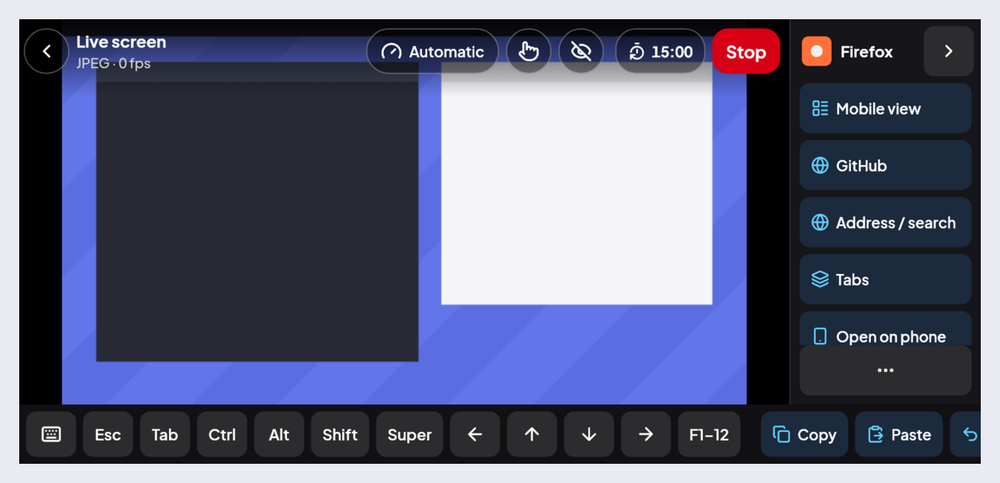

# Desktop control

Control the PC's desktop from the phone (Hyprland natively; Sway, X11, GNOME/KDE, Windows and macOS through the
[native helper](#other-desktops-native-helper)):

- the **desktop panel** (windows, workspaces, apps),
- the **live screen** (see the screen and use it by touch),
- **high quality mode** through Sunshine and Moonlight.

Anything that changes the desktop requires a short, visible **remote-control session**.

## Requirements

| Need | Used for |
|---|---|
| Agent feature `desktop` | panel (read-only), clipboard, screenshot, open on PC, live screen, Sunshine status, mobile view |
| Agent feature `control` (needs `desktop`) | everything that changes the desktop: window actions, workspace switch, DPMS, launching apps, live screen, Sunshine start/stop/pair, mobile view, Claude's PC tools |
| Hyprland (Wayland), with the agent running as the logged-in user | `hyprctl` and the event socket. Both classic `hyprland.conf` and Lua `hyprland.lua` (0.55+) configs are supported |
| `grim` | screenshots, window thumbnails, slow-mode live screen |
| `wl-clipboard` (`wl-paste`, `wl-copy`) | clipboard read, write and sync |
| `wf-recorder` | live screen (MJPEG, and H.264 with NVENC) |
| `ffmpeg` | WebP thumbnails (optional; falls back to PNG), Claude screenshots |
| `ydotool` with a running `ydotoold` | clicks, wheel, special keys. The socket defaults to `$XDG_RUNTIME_DIR/.ydotool_socket`; override it with `YDOTOOL_SOCKET` |
| `wtype` | typing text (any Unicode, independent of keyboard layout) |
| `gtk-launch` | launching apps |
| `notify-send` | PC-side control notice (optional; the window border still shows) |
| `rsvg-convert` | SVG app icons to PNG (optional; falls back to `ffmpeg`, then raw SVG) |
| NVIDIA GPU with NVENC, plus an H.264 decoder on the phone | H.264 live screen (optional; falls back to JPEG) |
| Sunshine on the PC, Moonlight on the phone | high quality mode (optional) |
| App lock (PIN or fingerprint) on the phone | opening a control session |

## Enable

In the app: *Settings › Hosts › argo › Agent settings › Features*. Turn on **Desktop (clipboard, screenshot)** and
**Remote control (windows, opening apps)**, then restart the agent. The `control` flag is also checked live:
turning it off ends any open control session immediately, along with the live screen, mobile view and Claude PC
tools. All keys are described in [Agent configuration](../agent/configuration.md).

## Remote-control session

All changing desktop endpoints require the token of an open control session, sent in the `X-Tiphys-Control` header.

- **Opening** a session asks for the app lock again. The token is kept only in memory on the phone. Each device can
  try to open a session at most 5 times per minute.
- A session lasts **15 minutes**. **Extend by 15 min** is available, and the remaining time is capped at **60
  minutes**. When the time runs out, the session closes by itself.
- There is **one session at a time**. If another device holds it, you get *Another device (…) is controlling the
  PC*. **Stop** is always allowed from any paired device.
- **PC-side indicator**: while a session is open, the active window border turns red to orange and is at least 3 px
  wide, and a critical "Tiphys remote control on" desktop notification appears. The previous border is saved to
  `control-indicator.json` and restored when the session ends. If the agent crashed during a session, the border is
  restored on the next start. If the indicator can't be shown, for example because Hyprland isn't running, the
  session is **not** opened.
- Opening and closing are recorded in the event log with the device, duration and reason. Tokens, keystrokes and
  content are never logged.
- The desktop screen closes its session when you leave it, or when the app stays in the background for more than
  60 seconds.

## Desktop panel

*System › Desktop* (agent `desktop`):

- **Workspaces** strip with window counts. Tapping one switches workspace.
- **Window cards** show a live thumbnail for windows on a visible workspace, or the app icon otherwise.
  - Tap: **Bring to front**.
  - Swipe: **Close window**, with a confirmation.
  - Long press: **Fullscreen**, **Float / tile**, **Pin on all workspaces**, **Move to workspace**,
    **Show this window** (live screen).
- **Apps** launcher built from your `.desktop` files. It has search, categories and recently used apps, and
  respects `NoDisplay`, `Hidden` and `OnlyShowIn`/`NotShowIn` for Hyprland. Apps start with `gtk-launch <id>`;
  `Exec=` lines are never run directly.
- **Tools**: media, clipboard, screenshot, **Turn the screen off/on** (DPMS), high quality mode, plus the
  [system](system.md) power actions.
- **Media** controls any MPRIS player (`playerctl`) and the system volume. When the player is
  [Velour](https://github.com/mikailustuner/velour) (YouTube Music), **Open Velour remote** opens a music app for it:
  - **Home · Explore · Search · Library** at the bottom, with a mini player above them (tap or swipe up for the full
    player, swipe sideways for the next/previous song). Home has your mixes and quick picks, Explore new releases,
    charts and moods; Search has suggestions; Library has playlists, albums, artists, liked songs and history.
  - **Full player**: the cover's colour behind it, swipe the cover for the next/previous song, double-tap to like,
    seek bar, shuffle/repeat, and a panel with **Up next** (jump, swipe to remove, drag to reorder, clear, save as a
    playlist), karaoke-style **Lyrics** (tap a line to jump there) and **PC**. Swipe down to close. Landscape puts
    the cover on the left.
  - **PC panel**: Velour's and the system's volume, the audio output (speakers, headphones…), equalizer presets, a
    **sleep timer** (15–60 minutes or the end of the song, fading out; then optionally turn the screen off or put the
    PC to sleep), turn the screen off while the music keeps playing, and bring Velour to the front.
  - **On the phone** (Android): controls on the lock screen and in the notification (also Bluetooth buttons), and
    while the remote is open the volume buttons change Velour's volume. Can be turned off in the PC panel.
  - The state is live: changes made on the PC show up at once.
  It needs Velour's *Settings → Desktop → Remote control*; see [security](../security.md#velour-remote). Live state,
  the sleep timer, the equalizer and Explore need a Velour from 2026-11-20 or later.

Browsing needs no session. The first changing action opens one, and a *Control on · 14:59 · Stop* bar stays at the
bottom while it is open.

There is no free-form `hyprctl dispatch`. Only a fixed list of actions is accepted, with a validated window address
(`0x…`), an integer workspace (1–100) and an app id that is in the list. Changing panel calls are limited to 10 per
5 seconds.

### Clipboard and open on PC

Clipboard is read with `wl-paste` and written with `wl-copy`. With `desktop.clipboardSync` on (the default; no
restart needed), text copied on the PC is sent to the phone as a silent notification with a **Copy** button. It is
skipped when:

- the text came from a password manager (`x-kde-passwordManagerHint`, or wl-clipboard's "sensitive" state),
- it isn't text,
- it is longer than 3 KB,
- it was just sent from the phone.

**Open on PC** accepts only `http`/`https` URLs. They open in Firefox through the [bridge](firefox-bridge.md) if it
is connected, otherwise with `xdg-open`. Clipboard text and URLs are never written to logs or the event log.

## Live screen

Open it from *Desktop › Live screen*, from a window's **Show this window**, or from a home shortcut. You can show
the whole focused monitor or a single visible window, in portrait or landscape.

**Touch:**

- **Direct touch** (default):
  - tap: left click. Two taps on the same spot: double click.
  - long press: right click.
  - one-finger drag: mouse drag.
  - two-finger drag: scroll.
  - pinch: zooms the picture on the phone only; nothing is sent to the PC.
- **Touchpad**: one finger moves the pointer relatively; tap clicks where the pointer is.
- **Keyboard bar**: on-screen keyboard, Esc, Tab, Ctrl, Alt, Shift, Super, arrows, F1–F12, Copy, Paste, Undo. When
  the agent reports the focused app, the app-aware [remote strip](remotes-and-mobile-view.md) appears above the bar
  (or on the right in landscape).
- **Top bar**: fps and latency, the session time left (tap to extend), **Quality** (Automatic, High, Medium, Low;
  codec Automatic, H.264 or JPEG), the touch mode, and **Stop**.

The stream stops when the app goes to the background. If the app stays there for more than 60 seconds, the control
session closes too.

### How it streams

The phone opens a WebSocket at `/v1/desktop/stream` with the control token; see [API](../agent/api.md).

| Mode | Pipeline | Limits |
|---|---|---|
| **JPEG** (default) | a single `wf-recorder -D … -c mjpeg` process. Each JPEG frame is one binary message, and identical frames are skipped | default 12 fps at 0.6 scale. JPEG is capped at 20 fps |
| **H.264** | `wf-recorder -c h264_nvenc` (ultra-low-latency preset, 2 s GOP, no B-frames). Annex-B access units go out, with SPS/PPS before each IDR, and the phone decodes with MediaCodec | up to 30 fps, 100–20000 kbit/s (default 2000). If NVENC gives no keyframe in time, the agent switches to JPEG (*H.264 is unavailable, switched to JPEG*) |
| **Slow mode** | a `grim` loop, used when `wf-recorder` is missing or fails | at most 4 fps, JPEG only |

Under backpressure, frames are dropped rather than queued. With H.264, nothing is sent until the next keyframe.
Quality changes restart the recorder and are limited to 6 per 10 seconds.

Input travels over the same socket:

- the pointer moves with `hyprctl` (`movecursor`, or `hl.dsp.cursor.move` in Lua mode),
- clicks and the wheel use `ydotool`,
- special keys use `ydotool key` from an allowed-key table. Letters and digits only work with Ctrl, Alt or Super,
- text uses `wtype` through stdin.

Every input event re-checks the token and is limited to **60 events per second**. Buttons still held when the
connection drops are released. The stream closes (code 4401) when control ends, the token changes, or `control` is
turned off.

After the first message, the agent also sends `focus` messages with the focused window's address, class, title and
matching app id. These come from Hyprland's event socket (`focus.ts`) and drive the remote strip.

## High quality mode (Sunshine and Moonlight)

For 60 fps hardware-encoded streaming, Tiphys manages [Sunshine](https://github.com/LizardByte/Sunshine) on the PC
and hands off to the Moonlight app on the phone. Open it from the live screen's quality menu, or from
*Desktop › Tools › High quality (Moonlight)*. The page shows the first thing that blocks you:

1. **Sunshine not installed**: copyable install commands. On Hyprland, `capture = wlr` needs no extra permission;
   if the picture stays black, try `capture = kms`.
2. **Stopped**: **Start Sunshine**. This runs `systemctl --user` on `app-dev.lizardbyte.app.Sunshine.service` or
   `sunshine.service` and needs a control session.
3. **Moonlight missing on the phone**: an install link.
4. **Ready**: **Open Moonlight**, plus **Enter Moonlight PIN**. In Moonlight you add the PC and tap it, and
   Moonlight shows a 4-digit PIN. Tiphys sends that PIN to Sunshine's web API, so you don't need the Sunshine web UI.

Setup:

- Create Sunshine's web user on the PC with `sunshine --creds USER PASSWORD`.
- Enter the same user name and password in *Agent settings › Sunshine (Moonlight)*. They are stored only in the
  agent config and sent to Sunshine with HTTP Basic auth.
- The API URL defaults to `https://127.0.0.1:47990`.

Status (installed, running, ports 47984/47989/47990/48010, capture, encoder, paired and pending clients) only needs
`desktop`. Start, stop and pair need `control` plus a session, and are limited to 6 per minute.

## Other desktops (native helper)

On desktops other than Hyprland the agent talks to a small native helper, `tiphys-desktop` (Rust, in
`desktop-helper/`; protocol in `desktop-helper/PROTOCOL.md`). It supports Sway, X11, GNOME/KDE on Wayland (through
xdg-desktop-portal), Windows and macOS. The phone uses the same screens; `GET /v1/desktop/capabilities` tells it what
this PC can do, and it hides the rest.

**Choosing the backend** (`desktop.backend` in the agent config, read at startup): `auto` (the default) uses Hyprland
when it finds a running Hyprland, otherwise the helper when it finds the binary (`desktop.helperPath`, else
`desktop-helper/target/release/tiphys-desktop` next to the agent, else `tiphys-desktop` on `PATH`), otherwise Hyprland
as before. Build the helper with `cargo build --release` in `desktop-helper/`. Nothing changes on Hyprland.

The helper starts only when a desktop endpoint is used, and stops after 60 s without requests (an open live screen
keeps it running), so it costs no memory while idle. If it crashes, the next request restarts it (with a growing
delay if it keeps crashing).

| | Hyprland | Helper |
|---|---|---|
| Window list, actions, workspaces | ✓ | ✓ where the platform exposes them (`portal` may lack windows); `pin` not available, `minimize`/`maximize` added |
| Thumbnails | WebP/PNG, visible workspace only | JPEG, not for minimized windows |
| Apps, icons, launch | `.desktop` + `gtk-launch` | the helper's list (Linux `.desktop`, Windows Start menu, macOS `/Applications`); icons on Linux only |
| DPMS, screenshot | ✓ | if the platform allows (macOS needs permission) |
| Live screen | MJPEG or H.264 (NVENC), grim fallback | MJPEG only, no cursor position in `hello` |
| Live input | `ydotool`, `wtype` | the helper (XTest, `SendInput`, `CGEvent`, wlr virtual input, portal); `KPPlus`/`KPMinus` not available |
| Clipboard | `wl-clipboard` + sync to the phone | `wl-clipboard` + sync on Wayland; elsewhere the helper, without sync |
| Control indicator on the PC | border + notification | none: the phone's *Control on* bar is the only sign |
| Mobile view (AT-SPI), Sunshine, Claude's PC tools, raising Firefox on tab switch | ✓ | not available (`agent.desktop.unsupported` / `agent.claude.pcUnavailable`) |
| Media, Velour, open on PC, Firefox bridge | ✓ | ✓ (media and open on PC use the Linux tools: `playerctl`, `wpctl`, `xdg-open`) |

**Permissions.** On macOS the helper needs *Accessibility* (input, window actions) and *Screen Recording* (screenshots,
live screen); a missing one answers `agent.desktop.permission` with its name. On GNOME/KDE Wayland the portal asks
once on the PC before the first input or screen capture.

## Limitations

- On Hyprland and, through the native helper, on other desktops (see above). Without either the panel shows
  *Hyprland is not running*; the app list still works.
- Thumbnails, Claude's focus and the mobile view only cover windows on a **visible** workspace, because Hyprland
  doesn't render other workspaces.
- H.264 needs NVENC (NVIDIA) on the PC. Otherwise you get JPEG.
- The live screen captures one monitor or one window at a time. There is one stream per device; a new connection
  replaces the old one (*opened in another connection*).
- Keys are limited to the allowed table. Punctuation keys are not sent as shortcuts; type them as text instead.

## Security notes

- Read-only views need a paired device. Every change needs `control`, a fresh app-lock unlock, a time-limited
  single-holder token, and per-session rate limits. A visible border and notification on the PC show when a session
  is open.
- No shell is used: every command is run with an argument array. Lua configs never receive client-supplied text.
- Sunshine's self-signed certificate is accepted **only on a loopback address**. When Sunshine's own certificate
  file is readable, the connection is pinned to it, and a mismatch aborts the request before credentials are sent.
  PINs and passwords are never logged.
- See [Security](../security.md) for the overall model and [Troubleshooting](../troubleshooting.md) for common
  problems (`ydotoold` not running, black Sunshine picture).

Related: [Claude using the PC](claude.md#use-the-pc-sessions), [Remotes and mobile view](remotes-and-mobile-view.md),
[Firefox bridge](firefox-bridge.md).
